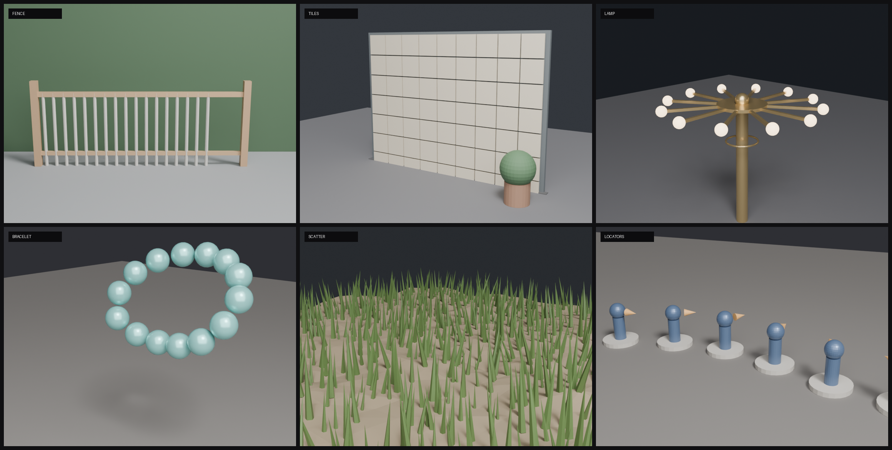

# Blender GN Arrays

Two reusable **Geometry Nodes** modifier groups in one asset file:

- **`Array`** — a general array modifier with six layouts (linear, grid, radial,
  curve, mesh surface, collection locators), three spacing modes (fixed step,
  fitted gap, fit-to-length), and random / mirrored / gradient copies.
- **`Hex Array`** — a honeycomb lattice filler with random picking from a
  collection, random size, jitter and yaw.



Built and tested on **Blender 4.5** (the asset also opens and evaluates in 5.2).
Both groups are normal *Geometry Nodes* modifier groups, marked as assets, so they
work in any `.blend` once you Append / Link them.

---

## Array

The design goal is to stop re-building the same node tree for every job: the
**layout** (where the points go) and the **spacing rule** (how far apart they are)
are separate choices, and the same group covers fences, tile grids, radial lamps,
beads on a curve, scattering on a surface, and placing objects at the pivots of a
collection.

### Quick start

1. **File → Append…** → `assets/geometry_nodes.blend` → **NodeTree** → `Array`.
2. On a mesh object add a **Geometry Nodes** modifier and pick `Array`.
3. Set **Mode** (`0`…`5`) and the inputs for that mode. The modifier UI is grouped
   into panels (`① 排列`, `② 環狀`, `③ 曲線與網格`, `④ 方向`, `⑤ 變化`, `⑥ 輸出`).

> **Mode is an integer.** Blender 4.5 has no Python API for creating the items of a
> menu socket on a node-group interface, so a real dropdown cannot be scripted into
> the asset. The mapping is in the socket's tooltip: `0 Linear · 1 Grid · 2 Radial ·
> 3 Curve · 4 Mesh · 5 Collection`. The same applies to `Spacing`, `Align`,
> `Mesh Mode` and the axis inputs.

### Layouts (`Mode`)

| Mode | Layout | What defines a point | Main inputs |
|---|---|---|---|
| `0` | **Linear** | a line along `Direction` | `Count`, `Direction`, `Step`/`Gap`/`Length` |
| `1` | **Grid** | an X/Y grid starting at the origin | `Count X`, `Count Y`, `Step`/`Gap`/`Length` |
| `2` | **Radial** | points on a circle / arc | `Count`, `Radius`, `Arc`, `Start Angle` |
| `3` | **Curve** | points along a Curve object | `Curve`, `Count`, `Step`/`Gap` |
| `4` | **Mesh** | vertices / edge midpoints / face centres / random on a surface | `Surface`, `Mesh Mode`, `Density` |
| `5` | **Collection** | the **origin + rotation** of every mesh object in `Point Collection` | `Point Collection` |

`Surface` empty means "use the host object's own geometry". `Curve` and
`Point Collection` are only evaluated in their mode.

### Spacing (`Spacing`)

| Value | Rule | Formula |
|---|---|---|
| `0` **Step** | fixed centre-to-centre distance | `step = Step` |
| `1` **Gap** | fit the unit's bounding box plus a gap | `step = extent + Gap` |
| `2` **Fit** | keep the count, fit the total length | `step = (Length − extent) / (Count − 1)` |

- `extent` for Linear is the unit bounding box projected on `Direction`:
  `|sx·dx| + |sy·dy| + |sz·dz|`.
- Grid applies the rule per axis (`extent.x`, `extent.y`, `Length`, `Length Y`).
- Fit makes the **outer edges flush**: the first unit's near edge starts at `0`,
  the last unit's far edge ends at `Length`. Linear/Grid still start at the origin
  for Step/Gap (Blender's array habit).
- Curve `Step`/`Gap` resamples the curve by length; `Fit` distributes `Count`
  points across the whole curve (centres at the ends). Curve `Gap` uses the unit's
  XY diagonal as its footprint.
- Radial ignores `Spacing`: the angle step is `Arc / Count` for a full circle and
  `Arc / (Count − 1)` for a partial arc.

### Orientation (`Align`)

| Value | Result |
|---|---|
| `0` **Natural** | Linear/Grid: as authored · Radial: rotated by the point angle · Curve: the curve frame (`Curve to Points`) · Mesh: **Z aligned to the surface normal** · Collection: the locator object's rotation |
| `1` **Forward** | align `Forward Axis` of the unit to the forward vector: `Direction` (Linear), curve tangent (Curve), edge direction (Mesh edges), radial tangent, or the locator's local X |
| `2` **Up** | align `Up Axis` to the up vector: surface normal (Mesh), radial outward, curve normal, or the locator's local Z |

Defaults: `Forward Axis = Y`, `Up Axis = Z` (Blender conventions).

### Variation

All variation is applied **after** instancing, so it composes with each unit's own
orientation:

| Input | Effect |
|---|---|
| `Random Offset` | per-copy translation, `±Random Offset` on each axis |
| `Random Rotate` | per-copy random Euler rotation, in degrees, `±` per axis |
| `Random Scale` | per-copy uniform scale, `1 ± Random Scale` |
| `Seed` | seed for all of the above |
| `Mirror` + `Mirror Axis` | every odd copy gets a negative scale on X / Y / Z |
| `Gradient Scale` | copy 0 is `1.0`, last copy is `Gradient Scale` (linear in copy order) |
| `Gradient Rotate` | last copy is twisted by this many degrees around Z |

### Unit source

- **Host** (default): the modifier object's own geometry is the unit. This is the
  familiar "duplicate myself" array.
- **Collection** (`Unit From Collection`): the unit is picked from `Collection`,
  randomly per copy using `Collection Count`. `Collection Info` uses
  *Separate Children* + *Reset Children*, so the unit objects' own location,
  rotation and scale are ignored — author the mesh, apply scale, keep the objects
  at the origin.
- **Collection locators** (`Mode = 5`): `Point Collection` is read for each mesh
  object's **origin and rotation** (via `Sample Index` on the instance domain) and
  the host geometry is placed there. Empties are not visible to Geometry Nodes, so
  use small mesh objects as locators (the `locators` demo hides nothing: the stones
  double as bases). Locator **scale is ignored**.

### Parameters

**① Arrangement**

| Input | Type | Default | Notes |
|---|---|---|---|
| `Mode` | Int | 0 | 0 Linear · 1 Grid · 2 Radial · 3 Curve · 4 Mesh · 5 Collection |
| `Unit From Collection` | Bool | false | unit from `Collection` instead of the host |
| `Collection` | Collection | – | unit source (random pick when several) |
| `Collection Count` | Int | 1 | number of mesh objects, for the random pick |
| `Direction` | Vector | (1, 0, 0) | Linear direction, object space |
| `Count` | Int | 5 | Linear / Radial / Curve(Fit) |
| `Count X` `Count Y` | Int | 5 | Grid |
| `Spacing` | Int | 0 | 0 Step · 1 Gap · 2 Fit |
| `Step` | Float | 1.0 | metres |
| `Gap` | Float | 0.1 | metres |
| `Length` `Length Y` | Float | 5.0 | Fit totals |

**② Radial** — `Radius` (1.0), `Arc` (360°, degrees), `Start Angle` (0°).

**③ Curve & Mesh** — `Curve` (Object), `Surface` (Object), `Mesh Mode`
(0 vertices · 1 edges · 2 faces · 3 surface), `Density` (10 pts/m²), `Point
Collection`.

**④ Orientation** — `Align` (0 Natural · 1 Forward · 2 Up), `Forward Axis`
(0 X · 1 Y · 2 Z), `Up Axis`.

**⑤ Variation** — `Random Offset`, `Random Rotate`, `Random Scale`, `Seed`,
`Mirror`, `Mirror Axis`, `Gradient Scale`, `Gradient Rotate`.

**⑥ Output** — `Realize` (false = instances, fast; true = real mesh for booleans,
export, or shading that needs unique geometry).

### Demo scenes

`demo/array_*.png` are rendered by `tools/gn/array_demo.py`:

| Scene | Shows |
|---|---|
| [fence](demo/array_fence.png) | Linear + Gap (posts + rails) |
| [tiles](demo/array_tiles.png) | Grid + Gap on a wall |
| [lamp](demo/array_lamp.png) | Radial with a unit offset from its origin |
| [bracelet](demo/array_bracelet.png) | Curve with a cyclic path |
| [scatter](demo/array_scatter.png) | Mesh → Surface, normals + random variation |
| [locators](demo/array_locators.png) | Collection mode: origin + rotation of locator objects |

Open [`demo/array_demo.blend`](demo/array_demo.blend) to inspect the fence scene:
the host carries the `Array` modifier with its inputs already set.

### Limits / gotchas

- `Gap` measures the unit's **bounding box**, not the exact silhouette. Rotated or
  irregular units can still touch; add a little extra gap.
- `Fit` keeps the count and changes the spacing. If the unit is larger than
  `Length`, the step clamps to 0.
- For `Unit From Collection`, the bounding box used by `Gap`/`Fit` comes from the
  realised collection, so objects authored far from the origin widen it. Keep unit
  meshes at the origin.
- `Collection Count` must match the real number of mesh objects in the unit
  collection, or the random pick can go out of range (the CLI fills it in).
- The host object's original geometry is replaced by the array; put the modifier
  before/after other modifiers accordingly.
- `Mirror` produces negative scales (flipped normals) on the mirrored copies. That
  is expected for symmetric parts; use `Realize` + *Flip Faces* if you need clean
  normals.

---

## Hex Array

Fills a honeycomb lattice with objects from a collection — random picking, random
size, spacing jitter and yaw.


- `Count Long` × `Count Short` cells, staggered rows
- one object per cell, randomly picked from `Collection` when it has several
- `Cell Size` drives the lattice spacing; `Spacing` scales it (1.0 = touching)
- `Size Random`, `Spacing Random`, `Yaw Random`
- `Stagger Columns` = pointy-top ↔ flat-top
- `Scale` scales the units without changing the lattice

Lattice formulas for circumradius `R = Cell Size / 2`:

| Orientation | dx | dy | Stagger |
|---|---|---|---|
| pointy-top (default) | `√3·R` | `1.5·R` | odd rows +`dx/2` in X |
| flat-top | `1.5·R` | `√3·R` | odd columns +`dy/2` in Y |

Both are multiplied by `Spacing`. `Cell Size` only changes spacing; use `Scale` to
scale the units. `Collection Info` uses *Reset Children*, so rotate/apply the mesh
rather than the object. See [`tools/gn/README.md`](tools/gn/README.md) for the full
hex parameter table and the node-by-node description.

Append it the same way (`assets/geometry_nodes.blend` → NodeTree → `Hex Array`).

---

## CLI, build and tests

```bash
# rebuild assets/geometry_nodes.blend from the Python generators (headless)
python3 tools/gn/gn.py build

# list / inspect a group (needs a running Blender + Blender Bridge)
python3 tools/gn/gn.py inputs --group array
# linear array fitted to 4 m, 9 copies
python3 tools/gn/gn.py apply --group array --object "Host" \
    --set mode=linear --set spacing=fit --set length=4 --set count=9
# 8 x 5 tile grid with a 1 cm gap
python3 tools/gn/gn.py apply --group array --object "Host" \
    --set mode=grid --set count_x=8 --set count_y=5 \
    --set spacing=gap --set gap=0.01

# render the six demo scenes + contact sheet
python3 tools/gn/gn.py array-demo --samples 32 --res 760

# smoke tests (16 checks: every mode, spacing, align, mirror, gradient, realize)
blender -b --factory-startup --python tools/gn/test_array.py
```

`apply` accepts enum names (`mode=grid`, `spacing=fit`, `align=up`,
`mesh_mode=surface`, `mirror_axis=z`, …) as well as numbers. Data-block sockets
(`Curve`, `Surface`, `Point Collection`) and the unit `Collection` are not set
through `--set`; use `--collection` for the unit collection and the modifier UI for
the object sockets. The CLI spawns
Blender 4.5 when present (`BLENDER_BIN` overrides it); the asset itself works in
4.5 and 5.2.

The bridge is optional — only `inputs`, `apply`, `list` and `demo` need a live
Blender. Building the asset and the demo renders run headless.

### Repository layout

```
assets/geometry_nodes.blend   Array + Hex Array node groups (assets)
assets/hex_array_nodes.png    Hex Array node diagram
demo/                         demo scene, renders, contact sheet
tools/gn/                     generators (array_gn.py, hex_array.py), build, CLI, tests, demo
tools/blender-bridge/         optional localhost bridge add-on for the CLI
```

### License

MIT — see [LICENSE](LICENSE).

---

## 中文說明

這個 repo 現在有兩個 Geometry Nodes modifier group，都在
`assets/geometry_nodes.blend`：

### Array（通用陣列）

`File → Append` → `assets/geometry_nodes.blend` → `NodeTree` → `Array`，加到物件上，
選 **Mode**：

- `0` 線性（Direction 方向）
- `1` 網格（Count X × Count Y，從原點往 +X/+Y）
- `2` 環狀（Radius、Arc、Start Angle）
- `3` 曲線（指定 Curve 物件）
- `4` Mesh（頂點／邊中點／面中心／表面隨機；可指定 Surface，留空用自己）
- `5` Collection（讀 `Point Collection` 裡每個物件的**原點＋旋轉**）

`Spacing` 決定間距算法：

- `0` Step：中心距固定
- `1` Gap：用單元 bounding box 貼齊，只留 `Gap` 的縫
- `2` Fit：數量不變，外緣對齊 `Length`（Grid 另有 `Length Y`）

`Align`：`0` Natural（各模式預設方向）、`1` Forward（前方軸對齊方向／切線）、
`2` Up（上方軸對齊法線）。`Forward Axis` 預設 Y、`Up Axis` 預設 Z。

`Unit From Collection` 打開時，單元從 `Collection` 隨機挑（`Collection Count` 要填對，
CLI 會自動填）。Collection 模式用的是 locator 物件的原點與旋轉，**不吃 scale**；
Empty 物件 GN 看不到，請用小 mesh 當 locator。

變化：`Random Offset`／`Random Rotate`／`Random Scale`／`Seed`、`Mirror`＋
`Mirror Axis`（每隔一份鏡像）、`Gradient Scale`／`Gradient Rotate`（沿順序漸變）。
`Realize` 打開會輸出實際 mesh（布林、匯出用）。

**Mode 是整數 0–5**：Blender 4.5 的 node group menu socket 沒辦法用 Python 建選項，
所以沒做成下拉選單；選項寫在 tooltip 裡。

`Gap` 是用 bounding box 量的，不是精確外型；`Fit` 在單元比 `Length` 大時間距會變 0。
Unit collection 的物件請把 scale 套用、留在原點（`Reset Children` 會忽略物件變換）。

### 建置與測試

```bash
python3 tools/gn/gn.py build                       # 重建 assets/geometry_nodes.blend
blender -b --factory-startup --python tools/gn/test_array.py   # 16 項檢查
python3 tools/gn/gn.py array-demo                  # 六個示範場景 + contact sheet
```

Asset 以 Blender 4.5 建置／測試，5.2 可正常開啟與評估（CLI 會優先找 4.5）。
