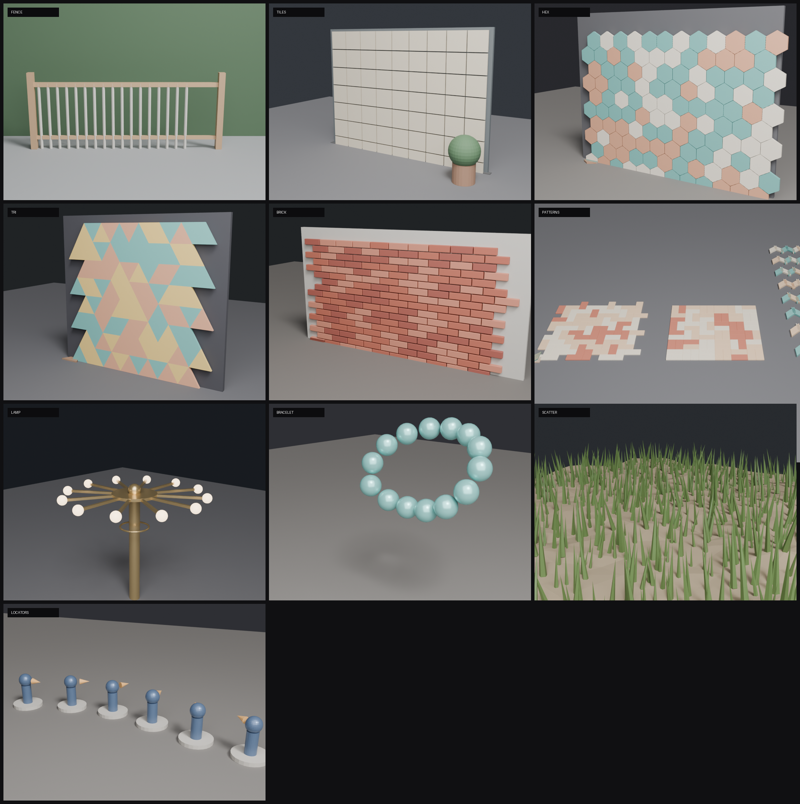

# Stan Array

A general-purpose **Geometry Nodes** array modifier for Blender — one node group
with six layouts, three lattice types inside Grid, and three spacing rules:

`Linear` · `Grid (XY / Hex / Triangle / Brick)` · `Radial` · `Curve` · `Mesh` ·
`Collection` — with `Step` / `Gap` / `Fit` spacing, orientation control, random
variation, alternating mirror, and gradient.



Built and tested on **Blender 4.5** (the asset also opens and evaluates in 5.2).
The group is marked as an **Asset**, so it works in any `.blend` once you Append /
Link it.

> **Migrating from Hex Array:** the old standalone `Hex Array` group is now
> **`Mode = Grid` + `Grid Type = Hex`**. The old group (and its demo) still live in
> the [`v1.0.0`](https://github.com/stansu/stan-array/releases/tag/v1.0.0) release
> and in git history.

---

## Quick start

1. **File → Append…** → `assets/geometry_nodes.blend` → **NodeTree** → `Stan Array`.
2. Add a **Geometry Nodes** modifier to a mesh object and pick `Stan Array`.
3. Set **Mode** (`0`…`5`) and fill the panel inputs. The modifier UI is grouped:
   `① 排列`, `② 環狀`, `③ 曲線與網格`, `④ 方向`, `⑤ 變化`, `⑥ 輸出`.

> **Mode is an integer.** Blender 4.5 has no Python API for creating the items of a
> menu socket on a node-group interface, so a real dropdown cannot be scripted into
> the asset. The mapping is in the socket's tooltip:
> `0 Linear · 1 Grid · 2 Radial · 3 Curve · 4 Mesh · 5 Collection`.
> The same applies to `Grid Type`, `Spacing Mode`, `Align` and the axis inputs.

## Layouts (`Mode`)

| Mode | Layout | Point source | Main inputs |
|---|---|---|---|
| `0` | **Linear** | a line along `Direction` | `Count`, `Direction`, `Step`/`Gap`/`Length` |
| `1` | **Grid** | XY grid, hex lattice, triangle tiling or brick bond | `Count X`, `Count Y`, `Grid Type`, `Cell Size`, `Flat Top`, `Stagger` |
| `2` | **Radial** | a circle / arc | `Count`, `Radius`, `Arc`, `Start Angle` |
| `3` | **Curve** | points along a Curve object | `Curve`, `Count`, `Step`/`Gap` |
| `4` | **Mesh** | vertices / edge midpoints / face centres / random surface | `Surface`, `Mesh Mode`, `Density` |
| `5` | **Collection** | the **origin + rotation** of every mesh object in `Point Collection` | `Point Collection` |

`Surface` empty means "use the host object's own geometry". `Curve` and
`Point Collection` are only evaluated in their mode.

### Grid types

| `Grid Type` | Lattice | Pitch | Stagger |
|---|---|---|---|
| `0` **XY** | square | `Step` per axis, or Gap / Fit | none |
| `1` **Hex** | honeycomb | `Cell Size` (hex diameter) | `Flat Top` = false: odd **rows** shift `dx/2`; true: odd **columns** shift `dy/2` |
| `2` **Triangle** | triangular **tiling** — triangle centroids on a honeycomb | `Step` = triangle side | every other cell rotated 180° (up/down) |
| `3` **Brick** | staggered brick courses | `Step`/`Gap`/`Fit` per axis | `Stagger` × brick length, advanced every `Stagger Repeat` courses |
| `4` **Herringbone** | 2:1 brick herringbone | `Count X`/`Count Y` = 4W cells, 8 bricks per cell | unit must be a 2:1 brick (L = 2W), centred |
| `5` **Chevron** | 45° chevron | `Count X`/`Count Y` = planks | unit must be a parallelogram with **vertical ends**, long axis +45°, centred |
| `6` **Basket Weave** | 2×2 blocks of H/V pairs | `Count X`/`Count Y` = blocks, 2 bricks per block | unit must be a 2:1 brick |

Hex math (`R = Cell Size / 2`):

| Hex orientation | dx | dy |
|---|---|---|
| pointy-top (`Flat Top` = false) | `√3·R` | `1.5·R` |
| flat-top (`Flat Top` = true) | `1.5·R` | `√3·R` |

`Cell Size` is the hex **diameter** (vertex to vertex) — make it slightly larger
than the tile to leave grout lines. Blender's 6-sided cylinder is pointy-top, so
use `Flat Top = false` with it. Hex and Triangle ignore `Spacing Mode`; the
lattice pitch comes from `Cell Size` / `Step`.

**Hex and Triangle are no longer the same lattice.** Hex places units at honeycomb
cell centres (for hex tiles). Triangle places equilateral-triangle **centroids** on
the dual honeycomb and rotates every other cell 180°, so triangle tiles actually
tessellate. `Count X` is the number of triangles per band and `Count Y` the number
of bands. The unit triangle must have its **centroid at the origin** and its apex
pointing **+Y** (Blender's 3-sided cylinder is already like this); down cells are
flipped automatically.

If you used Triangle as a plain point lattice in **v2.0.0**, reproduce it with
`Grid Type = Hex` and `Cell Size = Step / 0.866`.

Brick positions:

```
x = col·stepX + (floor(row / Stagger Repeat) · Stagger · stepX  mod  stepX)
y = row·stepY
```

`Stagger = 0` is stack bond, `0.5` running bond, `0.333` a 1/3 bond, `0.25` a
1/4 bond. `Stagger Repeat` keeps the same offset for N courses before advancing
(1 = every course). Brick uses the same `Step` / `Gap` / `Fit` as XY.

## Spacing (`Spacing Mode`)

| Value | Rule | Formula |
|---|---|---|
| `0` **Step** | fixed centre-to-centre distance | `step = Step` |
| `1` **Gap** | fit the unit's bounding box plus a gap | `step = extent + Gap` |
| `2` **Fit** | keep the count, fit the total length | `step = (Length − extent) / (Count − 1)` |

- `extent` for Linear is the unit bounding box projected on `Direction`:
  `|sx·dx| + |sy·dy| + |sz·dz|`.
- XY Grid applies the rule per axis (`extent.x`, `extent.y`, `Length`, `Length Y`).
- Fit makes the **outer edges flush**: the first unit's near edge starts at `0`,
  the last unit's far edge ends at `Length`. Step/Gap start at the origin.
- Curve `Step`/`Gap` resamples the curve by length; `Fit` distributes `Count`
  points across the whole curve (centres at the ends). Curve `Gap` uses the unit's
  XY diagonal as its footprint.
- Radial, Hex and Triangle ignore `Spacing Mode`.

## Orientation (`Align`)

| Value | Result |
|---|---|
| `0` **Natural** | Linear/Grid: as authored · Radial: rotated by the point angle · Curve: the curve frame (`Curve to Points`) · Mesh: **Z aligned to the surface normal** · Collection: the locator object's rotation |
| `1` **Forward** | align `Forward Axis` of the unit to the forward vector: `Direction` (Linear), curve tangent (Curve), edge direction (Mesh edges), radial tangent, or the locator's local X |
| `2` **Up** | align `Up Axis` to the up vector: surface normal (Mesh), radial outward, curve normal, or the locator's local Z |

Defaults: `Forward Axis = Y`, `Up Axis = Z` (Blender conventions).

## Variation

Applied **after** instancing, so it composes with each unit's own orientation:

| Input | Effect |
|---|---|
| `Unit Scale` | uniform scale multiplier for every unit (1 = as authored) |
| `Random Offset` | per-copy translation, `±Random Offset` on each axis |
| `Random Rotate` | per-copy random Euler rotation, degrees, `±` per axis |
| `Random Scale` | per-copy uniform scale, `1 ± Random Scale` |
| `Seed` | seed for all of the above |
| `Mirror` + `Mirror Axis` | every odd copy gets a negative scale on X / Y / Z |
| `Gradient Scale` | copy 0 is `1.0`, last copy is `Gradient Scale` |
| `Gradient Rotate` | last copy is twisted by this many degrees around Z |

## Unit source

- **Host** (default): the modifier object's own geometry is the unit.
- **Collection** (`Unit From Collection`): the unit is picked from `Collection`,
  randomly per copy using `Collection Count`. `Collection Info` uses *Separate
  Children* + *Reset Children*, so the unit objects' own transforms are ignored —
  apply scale, keep the meshes at the origin.
- **Collection locators** (`Mode = 5`): `Point Collection` is read for each mesh
  object's **origin and rotation** (via `Sample Index` on the instance domain) and
  the host geometry is placed there. Empties are invisible to Geometry Nodes, so
  use small mesh objects as locators. Locator **scale is ignored**.

## Parameters

**① Arrangement**

| Input | Type | Default | Notes |
|---|---|---|---|
| `Mode` | Int | 0 | 0 Linear · 1 Grid · 2 Radial · 3 Curve · 4 Mesh · 5 Collection |
| `Unit From Collection` | Bool | false | unit from `Collection` instead of the host |
| `Collection` | Collection | – | unit source (random pick when several) |
| `Collection Count` | Int | 1 | number of mesh objects, for the random pick |
| `Direction` | Vector | (1, 0, 0) | Linear direction, object space |
| `Count` | Int | 5 | Linear / Radial / Curve(Fit) |
| `Count X` `Count Y` | Int | 5 | Grid (Triangle: triangles per band × bands) |
| `Grid Type` | Int | 0 | 0 XY · 1 Hex · 2 Triangle |
| `Cell Size` | Float | 0.25 | hex diameter |
| `Flat Top` | Bool | false | hex orientation |
| `Stagger` | Float | 0.5 | Brick offset as a fraction of `stepX` (0 = stack, 0.5 = 1/2, 0.333 = 1/3) |
| `Stagger Repeat` | Int | 1 | courses per offset step (1 = every course, 2 = every two) |
| `Spacing Mode` | Int | 0 | 0 Step · 1 Gap · 2 Fit |
| `Step` | Float | 1.0 | metres (also Triangle side) |
| `Gap` | Float | 0.1 | metres |
| `Length` `Length Y` | Float | 5.0 | Fit totals |

**② Radial** — `Radius` (1.0), `Arc` (360°, degrees), `Start Angle` (0°).

**③ Curve & Mesh** — `Curve` (Object), `Surface` (Object), `Mesh Mode`
(0 vertices · 1 edges · 2 faces · 3 surface), `Density` (10 pts/m²), `Point
Collection`.

**④ Orientation** — `Align` (0 Natural · 1 Forward · 2 Up), `Forward Axis`
(0 X · 1 Y · 2 Z), `Up Axis`.

**⑤ Variation** — `Random Offset`, `Random Rotate`, `Unit Scale`, `Random Scale`,
`Seed`, `Mirror`, `Mirror Axis`, `Gradient Scale`, `Gradient Rotate`.

**⑥ Output** — `Realize` (false = instances, fast; true = real mesh for booleans,
export, or shading that needs unique geometry).

## Demo scenes

`demo/stan_*.png` (ten scenes) are rendered by `tools/gn/stan_array_demo.py`:

| Scene | Shows |
|---|---|
| [fence](demo/stan_fence.png) | Linear + Gap (posts + rails) |
| [tiles](demo/stan_tiles.png) | Grid XY + Gap on a wall |
| [hex](demo/stan_hex.png) | Grid Type = Hex, three tiles picked at random |
| [tri](demo/stan_tri.png) | Grid Type = Triangle — a real triangular tiling with alternating up/down cells |
| [brick](demo/stan_brick.png) | Grid Type = Brick — 1/2 running bond with mortar and mixed brick colours |
| [patterns](demo/stan_patterns.png) | Herringbone, Basket Weave and Chevron side by side |
| [lamp](demo/stan_lamp.png) | Radial with a unit offset from its origin |
| [bracelet](demo/stan_bracelet.png) | Curve with a cyclic path |
| [scatter](demo/stan_scatter.png) | Mesh → Surface, normals + random variation |
| [locators](demo/stan_locators.png) | Collection mode: origin + rotation of locator objects |

Open [`demo/stan_array_demo.blend`](demo/stan_array_demo.blend) to inspect the
fence scene: the host carries the `Stan Array` modifier with its inputs already
set.

## Herringbone, Chevron, Basket Weave

These three are 2D **patterns**, not simple course offsets:

- **Herringbone** (`4`): a 4W × 4W cell holds 8 bricks — four horizontal at
  `(0,0) (3,1) (2,2) (1,3)` and four vertical at `(2,0) (1,1) (0,2) (3,3)`,
  in units of `W`. Bricks cross cell edges, which is what makes the bond
  continuous. Requires a 2:1 brick (`L = 2W`) centred at its origin.
- **Basket Weave** (`6`): a 2W × 2W block holds two bricks. Blocks alternate
  orientation like a checkerboard: even blocks are two stacked horizontal bricks,
  odd blocks are two side-by-side vertical bricks. Requires a 2:1 brick.
- **Chevron** (`5`): planks sit at ±45° in a square lattice
  (`A = L/√2`, `H = W·√2`), with odd columns mirrored to make the V. The unit must
  be a **mitred parallelogram** with vertical ends and a +45° long axis (see the
  demo); a plain rectangle will show V-shaped grout gaps at the joints.

`Count X` / `Count Y` mean cells for Herringbone and Basket Weave (8 and 2 bricks
per cell), and planks for Chevron. All three are unit-size driven: author the
brick/parallelogram at its real size and keep it centred at the origin.

## Common brick & tile patterns

`Grid Type = Brick` covers every pattern that is a **repeating course offset**.
The value of `Stagger` is a fraction of one brick/tile length:

| Pattern | `Grid Type` | `Stagger` | `Stagger Repeat` | Typical use |
|---|---|---|---|---|
| Stack bond | Brick | `0` | `1` | modern tiles, stack bond feature walls |
| Running bond 1/2 | Brick | `0.5` | `1` | brick walls, subway tile |
| 1/3 bond | Brick | `0.333` | `1` | 300×600 large-format tiles |
| 1/4 bond | Brick | `0.25` | `1` | 600×1200 tiles, plank tile |
| 1/5 / 1/6 bond | Brick | `0.2` / `0.167` | `1` | long planks, minimal lippage |
| Offset every 2 courses | Brick | `0.5` | `2` | decorative block work |
| Hexagon | Hex | – | – | honeycomb tile, 200 mm across flats |
| Triangle | Triangle | – | – | triangle tiling, `Step` = side |
| Penny round / mosaic | XY | – | – | circles in a square grid, use `Gap` |
| Diagonal / 45° | XY or Brick | – | – | rotate the **host object** 45° |

Patterns that are **not** a single course offset need a different setup:

- **Herringbone / chevron** — bricks alternate 90°; build one array of horizontal
  and one of vertical bricks (or two rotated hosts) and offset them.
- **Basket weave** — 2×2 blocks alternate orientation; same two-array trick.
- **English / Flemish bond** — header and stretcher courses alternate; use two
  arrays (or a Collection with two brick lengths) rather than `Stagger`.

Typical real-world sizes (use metres in Blender; joints are the `Gap`):

| Material | Unit size | Joint |
|---|---|---|
| UK brick | 215 × 65 × 102.5 mm | 10 mm |
| US modular brick | 194 × 57 × 92 mm | 10 mm |
| Subway tile | 75 × 150 mm | 2–3 mm |
| Large-format tile | 300 × 600 mm | 2–3 mm, 1/3 bond |
| Plank tile | 150 × 900 mm | 2 mm, 1/3 or random |
| Hex tile | 200 mm across flats | 3 mm |
| Mosaic | 25 × 25 mm | 2 mm |

For brick, author the brick mesh at its real size and use `Gap` = joint; the
`Gap` mode measures the unit bounding box, so the pitch becomes
`brick + joint` automatically.

## Limits / gotchas

- `Gap` measures the unit's **bounding box**, not the silhouette. Rotated or
  irregular units can still touch; add a little extra gap.
- `Fit` keeps the count and changes the spacing. If the unit is larger than
  `Length`, the step clamps to 0.
- Hex and Triangle build a ragged staggered edge by design. A backing panel hides
  it; use `Flat Top` to choose which edge is ragged for Hex.
- Triangle expects a unit triangle whose centroid sits at the origin and whose apex
  points +Y; the down cells are rotated 180°, so an off-centre triangle will show
  seams.
- For `Unit From Collection`, the bounding box used by `Gap`/`Fit` comes from the
  realised collection. Keep unit meshes at the origin.
- `Collection Count` must match the real number of mesh objects, or the random
  pick can go out of range (the CLI fills it in).
- `Mirror` produces negative scales (flipped normals) on the mirrored copies. That
  is expected for symmetric parts; use `Realize` + *Flip Faces* if you need clean
  normals.
- The host object's original geometry is replaced by the array.

---

## CLI, build and tests

```bash
# rebuild assets/geometry_nodes.blend from the Python generator (headless)
python3 tools/gn/gn.py build

# list / inspect the group (needs a running Blender + Blender Bridge)
python3 tools/gn/gn.py inputs
python3 tools/gn/gn.py apply --object "Host" \
    --set mode=grid --set grid_type=hex --set cell=0.22 --set count_x=12
python3 tools/gn/gn.py apply --group stan --object "Host" \
    --set mode=linear --set spacing_mode=fit --set length=4 --set count=9

# render the eight demo scenes + contact sheet
python3 tools/gn/gn.py stan-demo --samples 32 --res 760

# smoke tests (27 checks: every mode, lattice, brick bond, patterns, spacing, align, mirror, gradient, realize)
blender -b --factory-startup --python tools/gn/test_stan_array.py
```

`apply` accepts enum names (`mode=grid`, `grid_type=hex`, `spacing_mode=fit`,
`align=up`, `mesh_mode=surface`, `mirror_axis=z`, …) as well as numbers.
Data-block sockets (`Curve`, `Surface`, `Point Collection`) and the unit
`Collection` are not set through `--set`; use `--collection` for the unit
collection and the modifier UI for the object sockets.

The CLI spawns Blender 4.5 when present (`BLENDER_BIN` overrides it); the asset
itself works in 4.5 and 5.2. The bridge is optional — only `inputs`, `apply`,
`list` and `reload` need a live Blender; building and demo renders are headless.

### Repository layout

```
assets/geometry_nodes.blend    Stan Array node group (asset)
demo/                          demo scene, renders, contact sheet
tools/gn/                      generator (stan_array.py), build, CLI, tests, demo, contact sheet
tools/blender-bridge/          optional localhost bridge add-on for the CLI
```

### License

MIT — see [LICENSE](LICENSE).

---

## 中文說明

**Stan Array** 是一個 Geometry Nodes modifier group：`File → Append` →
`assets/geometry_nodes.blend` → `NodeTree` → `Stan Array`，加到物件上，選 **Mode**：

- `0` 線性（Direction 方向）
- `1` 網格（**Grid Type**：`0` XY、`1` Hex、`2` Triangle、`3` Brick、`4` Herringbone、`5` Chevron、`6` Basket Weave）
- `2` 環狀（Radius、Arc、Start Angle）
- `3` 曲線（指定 Curve 物件）
- `4` Mesh（頂點／邊中點／面中心／表面隨機；Surface 留空用自己）
- `5` Collection（讀 `Point Collection` 裡每個物件的**原點＋旋轉**）

**Grid Type = Hex** 就是原本的 Hex Array：`Cell Size` 是六角外徑，
`Flat Top` 切 pointy/flat，`Count X/Y` 是格數。Blender 的 6 邊柱體是 pointy-top，
所以配 `Flat Top = false`。

**Grid Type = Triangle** 是真正的三角形貼磚：三角形質心排在蜂巢晶格上，
每隔一格自動轉 180°（up/down 交錯），所以三角形會密合。`Step` 是三角形邊長，
`Count X` 是每帶的三角形數、`Count Y` 是帶數。單元的**質心要在原點、頂點朝 +Y**
（Blender 的 3 邊柱體本來就是這樣）。

**Grid Type = Brick**：`Stagger` 是磚長的錯位比例（`0` 對齊、`0.5` 1/2、`0.333` 1/3、
`0.25` 1/4），`Stagger Repeat` 是每幾列推進一次（1 = 每列）。Brick 跟 XY 一樣吃
`Step` / `Gap` / `Fit`；用 `Gap` 當灰縫最方便，pitch 會自動是「磚 + 縫」。

**Herringbone（4）／Basket Weave（6）** 需要 2:1 的磚（長 = 2×寬、原點在中心）；
`Count X/Y` 是 4W 格／2W 區塊，每格分別 8／2 塊。**Chevron（5）** 需要「兩端垂直、
長軸 +45°」的平行四邊形單元，`Count X/Y` 是板數；用長方形磚會在 V 接縫留下三角形縫。

Hex/Triangle 不受 `Spacing Mode` 影響，間距由 `Cell Size` / `Step` 決定。

`Spacing Mode`：`0` Step（中心距固定）、`1` Gap（用 bounding box 貼齊留縫）、
`2` Fit（數量不變，外緣對齊 `Length`；Grid 另有 `Length Y`）。

`Align`：`0` Natural（各模式預設方向）、`1` Forward（前方軸對齊方向／切線）、
`2` Up（上方軸對齊法線）。`Forward Axis` 預設 Y、`Up Axis` 預設 Z。

`Unit From Collection` 打開時，單元從 `Collection` 隨機挑（`Collection Count` 要填對，
CLI 會自動填）。Collection 模式用的是 locator 物件的原點與旋轉，**不吃 scale**；
Empty 物件 GN 看不到，請用小 mesh 當 locator。

變化：`Unit Scale`（整體倍率）、`Random Offset`／`Random Rotate`／`Random Scale`／
`Seed`、`Mirror`＋`Mirror Axis`（每隔一份鏡像）、`Gradient Scale`／`Gradient Rotate`
（沿順序漸變）。`Realize` 打開會輸出實際 mesh（布林、匯出用）。

**Mode / Grid Type 是整數**：Blender 4.5 的 node group menu socket 沒辦法用 Python
建選項，所以沒做成下拉選單；對照寫在 tooltip 與上面的表。

`Gap` 是用 bounding box 量的，不是精確外型；`Fit` 在單元比 `Length` 大時間距會變 0。
Unit collection 的物件請把 scale 套用、留在原點（`Reset Children` 會忽略物件變換）。

### 建置與測試

```bash
python3 tools/gn/gn.py build                       # 重建 assets/geometry_nodes.blend
blender -b --factory-startup --python tools/gn/test_stan_array.py   # 27 項檢查
python3 tools/gn/gn.py stan-demo                   # 八個示範場景 + contact sheet
```

Asset 以 Blender 4.5 建置／測試，5.2 可正常開啟與評估（CLI 會優先找 4.5）。
