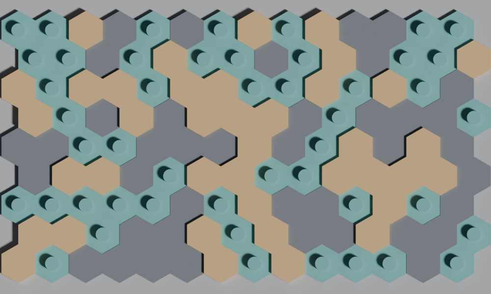
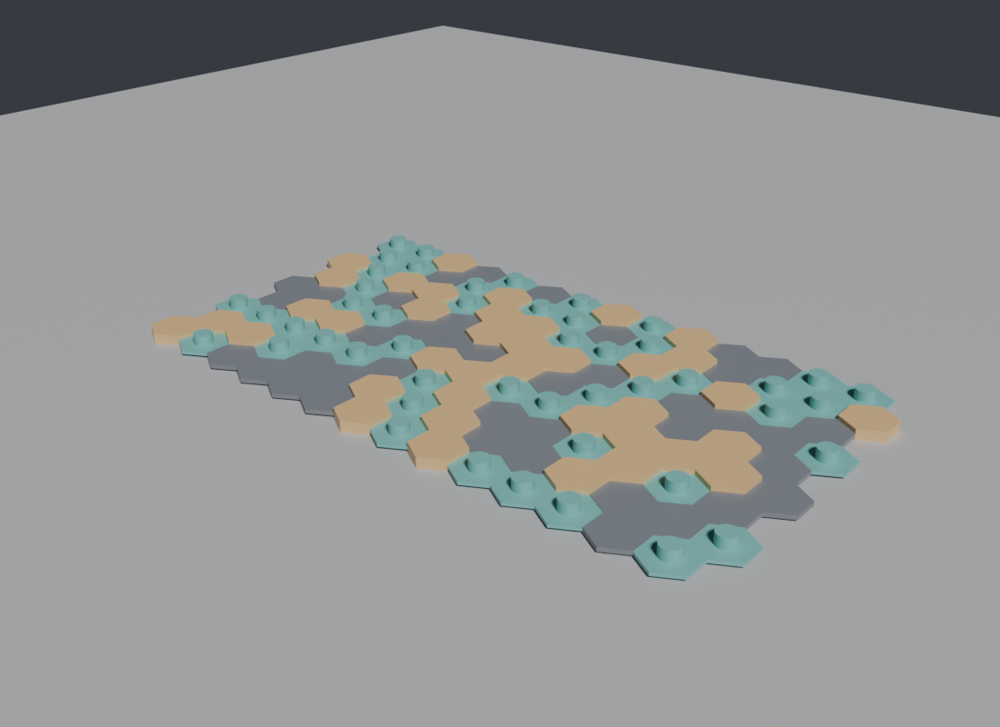
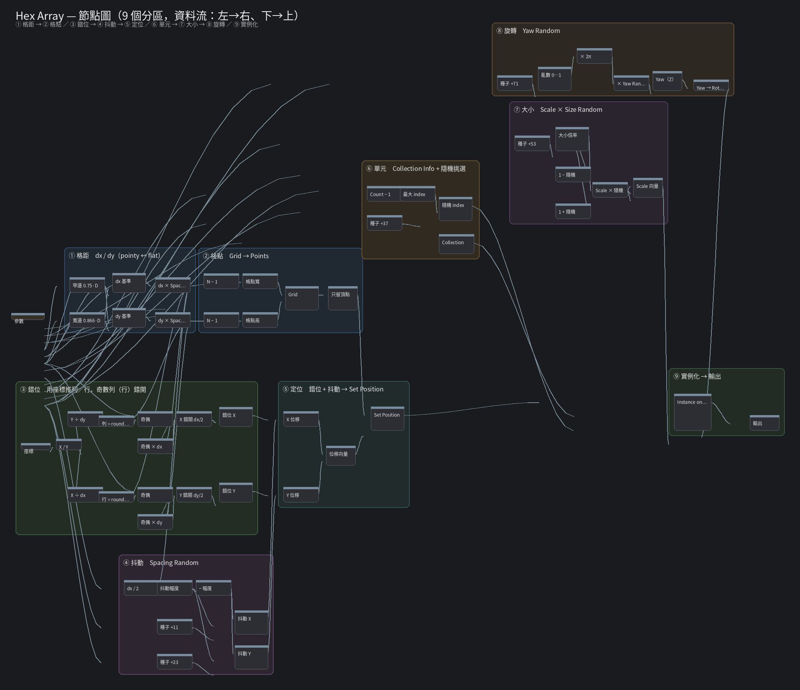

# Blender Hex Array

A reusable **Geometry Nodes** node group that fills a hexagonal (honeycomb) lattice
with objects from a Collection — with random picking, random size, random spacing
jitter and random yaw.





Built and tested on **Blender 4.5**. The node group is a normal *Geometry Nodes
modifier* group, so it works in any `.blend` once you Append / Link it.

## What it does

- `Count Long` × `Count Short` cells, staggered rows (honeycomb, not a square grid)
- each cell is an instance of an object from a **Collection**; if the collection
  has several objects, one is picked at random per cell
- `Cell Size` controls the cell diameter → lattice spacing
- `Spacing` (1.0 = cells touching) and `Spacing Random` (position jitter)
- `Scale` + `Size Random` for per-cell size variation
- `Yaw Random` for random rotation around Z
- `Stagger Columns` switches between **pointy-top** (Blender's default 6-sided
  cylinder) and **flat-top** hexagons

## Quick start

1. Download this repo (**Code → Download ZIP**, or grab the `.blend` files from
   [Releases](../../releases)).
2. In Blender: **File → Append…** → `assets/geometry_nodes.blend` → **NodeTree** →
   `Hex Array`.
3. Select a mesh object (an empty mesh works), add a **Geometry Nodes** modifier and
   pick the `Hex Array` group. Set **Collection** to the collection holding your
   hex tiles, then tune the numbers.

The group is also marked as an **Asset**, so if you save it into your own asset
library it shows up in the Asset Browser.

## Parameters

| Input | Type | Default | Description |
|---|---|---|---|
| `Collection` | Collection | – | Source objects for the cells (randomly picked when there are several) |
| `Count Long` | Int | 12 | Number of cells along X (the long side) |
| `Count Short` | Int | 8 | Number of rows along Y (the short side) |
| `Cell Size` | Float | 0.25 | Hex cell diameter (vertex to vertex), in meters — drives the lattice spacing |
| `Spacing` | Float | 1.0 | Center-distance multiplier: 1.0 = hexes touching, > 1 = gaps |
| `Stagger Columns` | Bool | False | False = pointy-top (rows staggered along X); True = flat-top (columns staggered along Y) |
| `Size Random` | Float | 0.0 | Random size variation (± fraction) |
| `Spacing Random` | Float | 0.0 | Position jitter, as a fraction of the spacing |
| `Yaw Random` | Float | 0.0 | Random rotation around Z (1 = full turn) |
| `Collection Count` | Int | 1 | Number of objects in the Collection, used for the random pick |
| `Scale` | Float | 1.0 | Cell size multiplier (1 = objects as authored) |
| `Seed` | Int | 0 | Random seed |

## How the lattice is computed

For a hexagon with circumradius `R = Cell Size / 2`:

| Orientation | dx (X spacing) | dy (Y spacing) | Stagger |
|---|---|---|---|
| pointy-top (default) | `√3·R` | `1.5·R` | odd rows shifted by `dx/2` in X |
| flat-top (`Stagger Columns` = true) | `1.5·R` | `√3·R` | odd columns shifted by `dy/2` in Y |

Both are multiplied by `Spacing`. Rows/columns are detected from the point
**position** (`round(Y/dy)`, `round(X/dx)`), not from the vertex index, so the
result does not depend on the grid's internal vertex order.

`Cell Size` only changes the spacing — it does **not** scale the instanced
objects. Use `Scale` for that (or author the tiles at the right size and keep
`Scale` at 1).

## Notes

- `Collection Info` uses **Reset Children**, which ignores the children's own
  location / rotation / scale. So the hex orientation has to live in the *mesh*,
  not in an object rotation — rotate/apply the mesh instead.
- `Collection Count` must match the real number of mesh objects in the
  collection, otherwise the random index can go out of range (the CLI sets it
  automatically).
- `Size Random` can make cells larger than the cell spacing, so neighbours may
  overlap. Push `Spacing` to 1.05–1.2 for gaps.
- The templates in the demo collection are hidden from render (`hide_render`);
  the array renders from the instances.

## Demo scene

[`demo/hex_array_demo.blend`](demo/hex_array_demo.blend) contains three demo tiles,
a floor, lights, a camera and the modifier already applied (tight honeycomb,
`Size Random` = 0). Open it and tweak the modifier inputs to see the effect.



## Optional: rebuild or drive a live Blender

The node group is generated from Python, so you can rebuild or script it:

```bash
# rebuild assets/geometry_nodes.blend from tools/gn/hex_array.py
python3 tools/gn/gn.py build

# list the node group's inputs
python3 tools/gn/gn.py inputs
```

`tools/gn/gn.py` can also apply the group to an object in a **running** Blender
through [`tools/blender-bridge`](tools/blender-bridge) (a small localhost socket
add-on — no authentication, keep it on `127.0.0.1`):

```bash
# install the add-on once, enable it once, then:
python3 tools/blender-bridge/session.py status
python3 tools/gn/gn.py apply --object "Hex Array Demo" --collection "Hex Tiles" \
    --set count_long=16 --set count_short=10 --set cell=0.2 --set seed=7
python3 tools/gn/gn.py demo          # rebuild the demo scene + render
```

## Repository layout

```
assets/geometry_nodes.blend   the node group (append from here)
assets/hex_array_nodes.png    node layout diagram
demo/                         demo scene + rendered previews
tools/gn/                     generator (hex_array.py), asset builder, CLI
tools/blender-bridge/         optional localhost bridge add-on for the CLI
```

## License

MIT — see [LICENSE](LICENSE).

---

## 中文說明（摘錄）

蜂巢狀陣列工具：`Count Long` × `Count Short` 個六角格點，每格從 Collection
隨機挑一個物件，可亂數大小、亂數間距、亂數旋轉。

**使用**：`File → Append` → `assets/geometry_nodes.blend` → `NodeTree` → `Hex Array`，
加到物件的 Geometry Nodes modifier 上，選好 Collection 即可。

**注意**：`Cell Size` 只決定格距，不會縮放單元物件（縮放用 `Scale`）；
六角方向由 mesh 本身決定（`Reset Children` 會忽略物件旋轉），
`Stagger Columns` 在 pointy-top / flat-top 之間切換。
